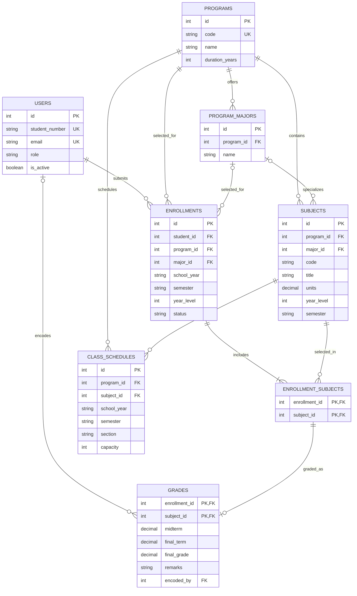

# Database relationship diagram

The schema is defined in `database/sql/schema.postgresql.sql`. Core relationships and data-integrity rules are represented below.

## Integrity rules worth explaining

- A student can have at most one enrollment per school year and semester (`uq_student_term`).
- An enrollment-subject selection is unique for its enrollment and subject pair.
- A grade references that same enrollment-subject pair, preventing a grade for a subject the student did not select.
- Program, major, subject, enrollment, schedule, and grade links use foreign keys with explicit delete behavior.
- Subject units, year level, semester, enrollment status, grade range, and grade remarks have database checks.
