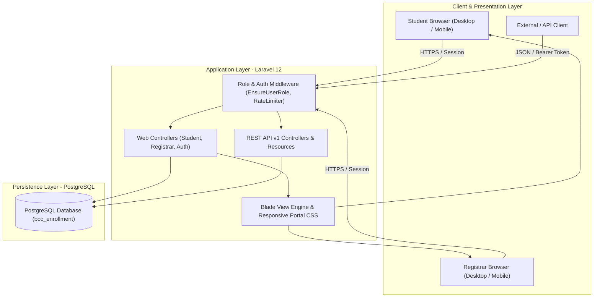
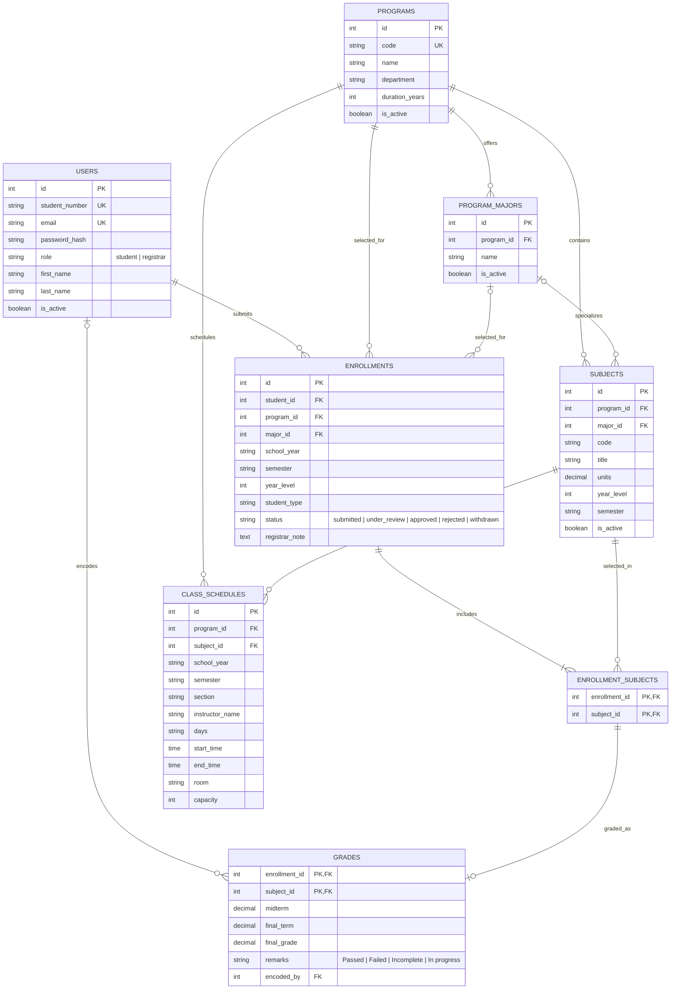

# Buenavista Community College (BCC)
## Online Student Enrollment & Grade Management System
### Technical Project Documentation & System Manual

---

## 1. Project Overview & Objectives

### 1.1 Purpose
The **BCC Online Enrollment System** is a responsive web application engineered for Buenavista Community College to modernize and streamline the academic enrollment and grading lifecycle. It replaces paper-based application queues with role-governed digital workflows for both students and the college registrar.

### 1.2 Core Capabilities
- **Student Portal**: Account registration, multi-program application submission, elective and major track selection, schedule viewing, application withdrawal, and grade inquiries.
- **Registrar Management Portal**: Real-time application triage (review, approve, reject, notes), student account directory with modal profile editing and access control, program catalog administration, curriculum subject catalog management with filters, and two-term grade encoding.
- **Two-Term Grade Calculation**: Streamlined grading using Midterm and Final marks with real-time average calculation:
  $$\text{Average} = \frac{\text{Midterm} + \text{Final}}{2}$$
  Automatic remark assignment: **Passed** ($\le 3.00$), **Failed** ($> 3.00$), or **Incomplete**.
- **RESTful API**: Version 1 endpoints (`/api/v1/`) providing headless programmatic access for catalog, enrollment, student, and grade querying.

---

## 2. System Architecture & Tech Stack

- **Backend Framework**: Laravel 12 (PHP 8.4)
- **Database Engine**: PostgreSQL with relational constraints, triggers, and indices
- **Frontend Layer**: Server-rendered Laravel Blade with pure CSS (zero external bundle dependency)
- **Authentication**: Stateful session auth with bcrypt hashing, role middleware, rate limiting, and CSRF protection
- **API Engine**: Laravel Sanctum / Token-based REST API with JsonResource transformation

### Architecture Flowchart


---

## 3. Database Schema & Entity Relationship Diagram (ERD)



---

## 4. REST API Documentation (v1)

| Method | Endpoint | Description | Auth Required |
| :--- | :--- | :--- | :--- |
| `GET` | `/api/v1/catalog/programs` | Retrieve all active degree programs | Public / Authenticated |
| `GET` | `/api/v1/catalog/subjects` | Filter curriculum subjects by program, year, or term | Public / Authenticated |
| `GET` | `/api/v1/students` | List student directory and enrollment metrics | Registrar Role |
| `GET` | `/api/v1/enrollments` | List enrollment applications with status filters | Authenticated |
| `GET` | `/api/v1/grades` | Query grades by student, term, or academic year | Authenticated |
| `PATCH`| `/api/v1/grades/{enrollment}/{subject}` | Encode/update midterm and final term marks | Registrar Role |

---

## 5. Automated Testing & Verification

The test suite is built on PHPUnit and executable via Laravel Artisan:
```sh
php artisan test
```

### Test Results
- **`RoleAccessTest`**:
  - `test_guest_is_sent_to_login_before_opening_student_workspace` (PASS)
  - `test_student_cannot_open_registrar_tools` (PASS)
  - `test_registrar_cannot_open_student_workspace` (PASS)
- **`GradeCalculationTest`**:
  - `test_grade_averaging_midterm_and_final` (PASS) — Asserts `(1.75 + 1.25) / 2 = 1.50` yields `Passed`.
  - `test_failing_grade_sets_remark_to_failed` (PASS) — Asserts `(3.50 + 3.25) / 2 = 3.38` yields `Failed`.

**Summary**: 5 tests, 15 assertions, 100% pass rate in ~700ms.
