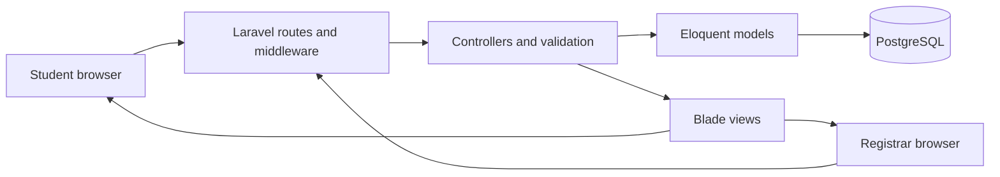

# System overview

## Purpose

The BCC Online Enrollment portal supports student enrollment applications and registrar operations for Buenavista Community College. It is a server-rendered Laravel application using Blade views, PostgreSQL, and session-based authentication.

## Main roles

- **Student:** creates an account, signs in, selects a program and subjects for a term, submits an application, checks application history, withdraws an eligible application, and views grades.
- **Registrar:** reviews applications, manages student access, maintains programs and subjects, and encodes term grades.

Role middleware protects the student and registrar route groups. Authentication endpoints are rate-limited. Request validation and database constraints protect submitted values and relationships.

## Typical enrollment workflow

1. A student registers or signs in.
2. The student creates an application by choosing a program, academic term, year level, and eligible subjects.
3. The application and selected subjects are stored as an enrollment with a pending review status.
4. A registrar reviews the application and approves or rejects it.
5. For approved enrollments, the registrar records grades against the selected subjects.
6. The student views the enrollment and recorded grades in the student workspace.

## Request and data flow

## Demonstration checklist

1. Sign in as the seeded student, create an enrollment application, and show it in application history.
2. Sign out and sign in as the registrar; review that application.
3. Show program and subject catalog management.
4. Encode grades for an approved enrollment and show the result from the student view.
5. Show the same screens at a narrow mobile viewport and explain pagination, search, and role-restricted navigation.

Use the local demo accounts in the README only for classroom demonstration. Avoid using real student records in screenshots or presentations.

## REST API Endpoints (v1)

- `GET /api/v1/catalog/programs` — List supported academic programs
- `GET /api/v1/catalog/subjects` — List curriculum subjects with program/year/term filters
- `GET /api/v1/students` — List student directory (registrar authorized)
- `GET /api/v1/enrollments` — List enrollment applications with status filters
- `GET /api/v1/grades` — Retrieve student grade records
- `PATCH /api/v1/grades/{enrollment}/{subject}` — Record midterm and final term grades

## Automated Test Coverage

Automated PHPUnit feature tests (`php artisan test`) verify:
- Guest redirection and unauthenticated route protection.
- Role-based access control (students blocked from registrar management tools; registrars redirected from student enrollment workspace).
- Two-term grade calculation logic: real-time averaging `(midterm + final) / 2` and automatic remark classification (`Passed` for $\le 3.00$, `Failed` for $> 3.00$).
